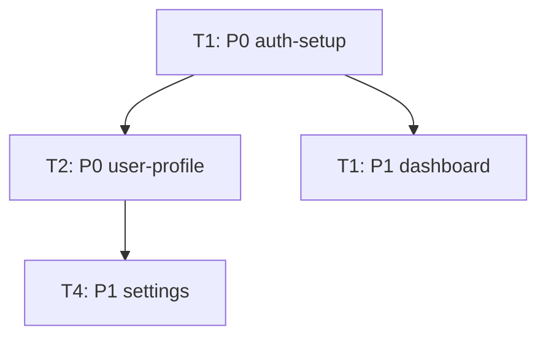

<!-- HITL-GATE-POLICY:start -->
## ⛔ HITL Gate Contract (read before running any phase)

This step is **human-in-the-loop**. Every `<HARD-GATE>` below is a **hard stop**. Obey these rules exactly — they override any default to "keep going."

**Runtime adapter:** `AskUserQuestion` below means the host's supported user-question mechanism, not a required tool identifier. Use an available structured question tool only when it permits this kind of question. Otherwise ask in a normal response and end the turn at the gate. A tool that cannot collect approval is not an approval substitute. Frontmatter controls are host-specific: supported `allowed-tools` can preapprove tool access. Tool access does not authorize actions outside the user's scope or satisfy a phase, release or production approval.

1. **Ask, then wait.** At each `<HARD-GATE>` you MUST call `AskUserQuestion` and receive an **actual answer from the user** before starting the next phase. Producing the analysis for a phase is allowed; *advancing past its gate* is not, until the user answers.
2. **A non-answer is NOT approval.** If `AskUserQuestion` returns no response, times out, or says the user is away — **PAUSE the step and wait**. Do not "proceed on best judgment," do not draft the remaining phases, do not infer approval from silence. Save what you have, tell the user the step is paused at Phase _X_ awaiting their answer, and stop. Re-ask when they return.
3. **One gate per phase — never collapse them.** Ask each phase's gate at its own phase boundary (A, then B, then C…). Do not batch several phases into a single question, and do not run multiple phases and ask once at the end. The founder decides at every boundary.
4. **The only way to skip gates** is an explicit, up-front instruction from the user in *this* run — e.g. "run all phases without stopping," "autonomous mode," or "don't ask me, just draft it." Absent that explicit opt-in, gates are mandatory. Being mid-task, low on time, or unattended is never such an opt-in.
5. **Everything before an approval is a draft.** Nothing a gate guards is "locked" or "done" until the user has approved it at that gate.

**Explicit unattended runs:** Record the user's opt-in and its scope once. Complete authorized phases and local verification without repeatedly asking for the same permission. Mark decisions made under that delegation as assumptions or delegated decisions, not fabricated user answers. Unattended drafting does not grant release, spending, destructive-action or production authority. A genuine missing decision may block one part while independent authorized work continues.

> If you find yourself about to write the next phase without a user answer to the current gate, STOP — that is the exact failure this contract prevents.
<!-- HITL-GATE-POLICY:end -->

<!-- GAME-DOMAIN:start -->
## Conditional game-domain adaptation

Apply this section only when `docs/stack-profile.json` records `projectDomain: "game"`. A missing value means `general`; do not infer a game domain from product language. Keep this step's number, phases, outputs, gates, business functions, GTM, context, and handoff intact.

Read the selected entry from the canonical game-development catalog when it is available. Use only the workflows and questions applicable to the recorded game profile. If applicability is unknown, record it as unresolved; defer or skip work only with a reason. The catalog adapts this step. It does not create an alternate numbered sequence.

- Default to a solo creator. Contributor idea packs are separately authored, workspace-visible planning inputs; synthesis is an explicit creator decision that preserves selected revisions, attribution, disagreement, and rejected alternatives.
- Treat prototypes, art, audio, engine setup, imports, builds, performance measurements, multiplayer checks, and playtests as external execution. This Protocol step may prepare a decision, brief, checklist, or evidence requirement. Mark execution evidence `NOT-EXECUTED` until real evidence is attached and reviewed.
- Choose the smallest experiment that tests the current uncertainty. Do not require paper prototypes, outside testers, fixed art freezes, an engine, a team size, a schedule, or a downstream production method unless the creator records why it applies.
- Keep claims classified: source text, observed evidence, source claim, untested integration, or proposed adaptation. Preserve the catalog source IDs and linked research when creating game artifacts.

<!-- GAME-DOMAIN:end -->

<!-- SKILLS-INVOKE:start -->
## Required skills — invoke the live skills (do NOT rely on embedded summaries)

This step's output quality depends on these skills. **Invoke each via the host's installed Skill catalog by name at the relevant phase.** If the host cannot resolve that name, read the project source at `src/skills/<skill>/SKILL.md`, then the bundled `.agents/skills/<skill>/SKILL.md` when present. Do not rely on embedded summaries.

- `game-development` — conditional when `projectDomain: "game"`; select this step's catalog entry and applicable workflow

- `prd-patterns`
- `quality-gates`

- `holes` — mandatory pre-approval gap pass (invoke via `$holes` or Skill tool at the step's final gate)

If a skill is unavailable on this surface, state that and continue; never silently skip it.
<!-- SKILLS-INVOKE:end -->


# /step-11.5-task-handoff — Vendor-Neutral Execution Handoff

**On start, announce:** "Running Step 11.5: Task Handoff. I'll generate a TASKS.md execution manifest from your approved Step 11 PRDs — structured for collision-free claiming by any agent fleet."

<goal>
You are the Execution Handoff Lead. Execute ALL phases (A through D) in order.

| Phase | Purpose | Output |
|-------|---------|--------|
| A | PRD Import & Dependency Extraction | Confirmed task list from approved Step 11 PRDs |
| B | Priority + Dependency Graph | P0-P3 classification, topological sort, graph edges |
| C | TASKS.md Generation | Vendor-neutral handoff manifest with claim fields |
| D | Loop Contract + Hardening | /next-task contract, $holes pass, status sync |

Required Output:
- `.sigma/backlogs/<mode>/TASKS.md` (canonical task handoff manifest)
- Optional: `.sigma/backlogs/<mode>/TASKS.json` (machine-parseable mirror)

Quality gate: every task has EARS criteria, Files-to-Touch, Files-NOT-to-Touch, and a non-empty dependency edge list (or explicit `none`).

**Core principle:** TASKS.md is consumed by autonomous agents, not read in planning meetings. Every entry must be self-contained enough to identify its source, scope, verification, and any ambiguity. Do not invent clarification-free work from an ambiguous PRD: mark the task `BLOCKED / clarification required` with the exact missing decision.
</goal>

---

Appetite is copied verbatim from the approved Step 10/11 time budget; it is not an effort estimate. Retain a legacy S/M/L value only as an unresolved size label, never infer a duration from it. Resolve a missing budget at the existing approval gate before marking the task ready.

## Step Boundary

- **Step 11.5 owns:** TASKS.md generation from accepted PRDs, P0-P3 classification, dependency graph, claim fields, per-task Files-to-Touch + Files-NOT-to-Touch, EARS criteria references back to the originating PRD, /next-task autonomous-loop contract, collision-free claiming protocol.
- **Step 11.5 does NOT own:** PRD content (Step 11), architecture decisions (Step 8), skill/agent assignment (Step 13), runtime wiring (Step 14).
- **Do NOT** re-author PRD requirements. Pull them verbatim from Section 4 (Functional Requirements) and Section 10 (Testing & Acceptance) of each Step 11 PRD.

---

## TASKS.md Specification

### Task Entry Format

Each task entry in TASKS.md follows this canonical structure:

```markdown
## T[N]: [feature-id]-[short-name]

**PRD:** docs/prds/F<wave:02d>.<feature:03d>-<slug>.md (Section 4, Req [IDs])
**Source:** `<commit-or-blob-hash>` / extracted `<timestamp>` / parser `<version>`
**Priority:** P0 | P1 | P2 | P3
**Appetite:** [approved fixed time budget from Step 10]
**Status:** unclaimed

### Claim
- **agent:** (unclaimed)
- **claimed_at:** —
- **worktree:** —
- **reservation receipt:** —
- **lease / recovery policy:** —

### Description
[One-paragraph description. Pulled from PRD Section 1. Do not re-author.]

### Acceptance Criteria (EARS)
- WHEN [event] THE SYSTEM SHALL [response]
- WHILE [state] THE SYSTEM SHALL [behavior]
- IF [precondition] THE SYSTEM SHALL [response]

*Source: PRD Section 10, test rows [N].*

### Files to Touch
- `[path]` — [why, from PRD Section 12]
- `[path]` — [why]

### Files NOT to Touch
- `[path]` — owned by [F-ID]; requires a separate PRD
- `[path]` — runtime config; never modified by feature PRDs

### Dependencies
- Blocked by: T[N] ([reason]), T[N] ([reason])
- Blocks: T[N] ([reason])

### Testing Command
```bash
[exact command from PRD Section 12]
```

### Agent Notes
[Key contracts from PRD Section 12 the implementing agent must respect. Pull verbatim.]
```

---

## Priority Classification

| Priority | Criteria | Examples |
|----------|----------|---------|
| **P0** | System cannot ship without this — blocks other features or is the core value loop | Auth, data model migrations, primary CRUD |
| **P1** | Must ship in this release — users need it to get value | Core UI screens, primary API endpoints |
| **P2** | Should ship — meaningful improvement, no blocking dependency | Secondary flows, enhancements, edge cases |
| **P3** | Nice to have — polish, optimization, non-critical | Copy tweaks, visual polish, minor convenience |

P0/P1 tasks block release. P2/P3 tasks are ship-if-done.

---

## Dependency Graph Rules

Every task must declare its dependency edges explicitly:

```
T1 (P0, F01-auth-setup)
  └─ blocks: T2, T3, T4

T2 (P0, F02-user-profile) — blocked by T1
T3 (P1, F03-dashboard) — blocked by T1
T4 (P1, F04-settings) — blocked by T1, T2
```

Graph construction rules:
- **Import edges** from Step 10's `FEATURE-DEPENDENCIES.md` if it exists.
- **Derive structural edges** from PRD Section 2 (Dependencies) and Section 5 (Data Model Delta), then label every edge `declared`, `structural`, or `inferred` with its source and confidence. Do not assume that a table change blocks every reader when migrations, flags, or mocks make the relationship conditional.
- **No circular dependencies** — if a cycle is detected, flag it and halt with: "Dependency cycle detected between [T-IDs]. Resolve in Step 10 before generating TASKS.md."
- **List `none` explicitly** when a task has no blockers — do not leave the field empty.

---

## Claim Protocol (Collision-Free Multi-Agent)

The claim fields enable multiple agents to work in parallel without stomping each other:

```markdown
### Claim
- **agent:** sigma-backend-01
- **claimed_at:** 2026-06-10T14:23:00Z
- **worktree:** feature/T3-dashboard-alpha
- **reservation receipt:** tracker claim / lock / coordinator receipt
- **lease / recovery policy:** owner-approved policy reference
```

**Claim rules:**
1. An agent reads the TASKS.md and finds the first unclaimed task with no uncompleted blockers (status of all `blocked-by` tasks is `done`). It may start only after an existing serialized coordinator, transactional tracker claim, lock, or isolated-worktree reservation records `agent:`, `claimed_at:`, `worktree:`, and a receipt.
2. A Markdown edit or later commit conflict is not a reservation proof. Without a demonstrated reservation mechanism, mark the queue `QUEUE_ONLY / concurrent execution unsupported` and do not begin concurrent claims.
3. `status:` transitions: `unclaimed` → `in-progress` → `review` → `done` | `blocked` | `skipped`.
4. A task moves to `blocked` when a dependency slips — the agent unsets the claim and re-queues.
5. No agent may modify another agent's claimed task without first declaiming it (setting `agent: (unclaimed)`).

---

## /next-task Autonomous-Loop Contract

The `/next-task` selector is available only when `scripts/next-task.sh` is present in the consuming project. Detect that file before documenting or invoking it. When it is present, it parses TASKS.md, resolves blockers, and prints the next claimable task (exit 3 = fleet idle, never spin); it does not reserve that task:

```
bash scripts/next-task.sh [--mode implementation|prototype] [--agent <name>] [--priority P0|P1|P2|P3] [--dry-run]
```

When the script is absent, retain TASKS.md as the durable queue and record the manual fallback: select the highest-priority unclaimed task with completed blockers, reserve it through an existing serialized coordinator or transactional claim mechanism, then update its status through review and merge. Without a demonstrated mechanism, mark the queue `QUEUE_ONLY / concurrent execution unsupported`; do not run concurrent claims or claim that `/next-task` or an overnight loop is installed. Record a lease/expiry, recovery path, and owner-approved policy before reclaiming abandoned work.

**Resolution algorithm (script or manual fallback):**
1. Read `.sigma/backlogs/<mode>/TASKS.md`.
2. Filter to tasks where `status == unclaimed`.
3. Filter out tasks where any entry in `blocked-by` has `status != done`.
4. Sort by priority (P0 first), then by task number.
5. Return the first result without claiming it. Reserve the returned task through the demonstrated coordinator, transactional claim, lock, or isolated-worktree mechanism before work starts.

**Loop harness pattern** (for overnight/cron runs):
```
while /next-task --agent $AGENT_ID returns a task:
  reserve the task through the project's demonstrated coordinator, transactional claim, lock, or isolated-worktree mechanism
  implement the task
  run the testing command
  open PR with title "[T-ID] [short-name]"
  move status to "review"
  wait for merge or rejection signal
done
echo "All tasks claimed or blocked. Fleet idle."
```

**Fleet idle condition:** when `/next-task` returns no task, the fleet is idle. The harness should emit a summary (tasks done, tasks blocked, tasks in-review) and stop — never spin on empty.

---

## Phase A — PRD Import & Dependency Extraction

### Upstream Requirements

| Artifact | Source Step | Required |
|----------|-----------|----------|
| `docs/prds/F<wave:02d>.<feature:03d>-<slug>.md` | Step 11 | **Yes** — one per feature; must be approved |
| `docs/prds/.prd-status.json` or Linear project | Step 11 | **Yes** — filters to `approved: true` tasks only |
| `docs/implementation/FEATURE-DEPENDENCIES.md` | Step 10 | Conditional — import edges if present |
| `docs/technical/TECHNICAL-SPEC.md` | Step 8 | Advisory — shared contract reference |

**Mode detection:**
- If `--mode implementation` (default): read `docs/prds/*.md` and target `.sigma/backlogs/implementation/TASKS.md`.
- If `--mode prototype`: read `docs/prds/flows/*/FLOW-*.md` and target `.sigma/backlogs/prototype/TASKS.md`.

### Preflight (auto)

1. Run `date +"%Y-%m-%d"`.
2. Read `.prd-status.json` (or query the Linear project for feature issues in `Done` state — PRD approved).
3. List approved PRDs: `docs/prds/F*.md` where `approved == true` (canonical ID format `F<wave:02d>.<feature:03d>-<slug>`).
4. For each PRD, extract: feature ID, priority, appetite, dependencies (Section 2), functional requirements (Section 4), acceptance criteria (Section 10), file paths (Section 12), testing command (Section 12).
5. If fewer than 1 approved PRD exists → halt: "Step 11.5 requires at least 1 approved Step 11 PRD. Approve PRDs in Step 11 first."

### Confirm task list

Present the extracted task list:

| Task ID | PRD | Priority | Appetite | Blockers |
|---------|-----|----------|----------|---------|
| T1 | F01-auth | P0 | [approved time budget] | none |
| T2 | F02-profile | P0 | [approved time budget] | T1 |

<HARD-GATE>
Do NOT proceed to Phase B until user approves task list.
Use AskUserQuestion: "Extracted [N] tasks from [M] approved PRDs. Approve for TASKS.md generation?"
Options: [Approve — generate TASKS.md, Adjust priorities, Add missing tasks, Go back to Step 11]
</HARD-GATE>

---

## Phase B — Priority + Dependency Graph

### Priority assignment

Import priorities directly from Step 10 PRD Eligibility Table. Override only when:
- A P1 task has a P0 hard dependency → escalate to P0.
- A P0 task is purely cosmetic (UI-only, no data/logic) → discuss with user; do not auto-downgrade.

### Graph construction

1. Start with an empty directed graph G = (V, E).
2. For each task T: add vertex T to G.
3. For each PRD Section 2 dependency: add directed edge T_dependent → T_blocker.
4. For each structural dependency detected (e.g., Task A creates a table that Task B reads): add the edge.
5. Run topological sort. If a cycle exists: halt with the cycle description.
6. Present the graph visually in Mermaid `graph TD` notation.



<HARD-GATE>
Do NOT proceed to Phase C until user approves the dependency graph.
Use AskUserQuestion: "Dependency graph complete. [N] edges, [M] root tasks (no blockers). Approve?"
Options: [Approve — write TASKS.md, Adjust edges, Adjust priorities]
</HARD-GATE>

---

## Phase C — TASKS.md Generation

Write `.sigma/backlogs/<mode>/TASKS.md`.

### File header

```markdown
# TASKS.md — Sigma Execution Handoff
<!-- generated by step-11.5-task-handoff -->
<!-- mode: implementation | prototype -->
<!-- generated: YYYY-MM-DD -->
<!-- source: docs/prds/ -->

## Fleet Status

| Metric | Count |
|--------|-------|
| Total tasks | [N] |
| Unclaimed | [N] |
| In progress | 0 |
| Done | 0 |
| Blocked | 0 |

## Dependency Graph

[Mermaid graph from Phase B]

## Tasks
```

### Task entries

Write one entry per task following the canonical format. Entries are ordered by topological sort (roots first, then dependents).

**Extraction rules (per task):**
- `Description` → pull from PRD Section 1 (Problem & Outcome). Maximum 3 sentences. Do not paraphrase.
- `Acceptance Criteria` → pull EARS predicates from PRD Section 10 verbatim. If the PRD has prose criteria (not yet converted to EARS), convert them now and note the conversion.
- `Files to Touch` → pull from PRD Section 12 exactly. Never add files not listed there.
- `Files NOT to Touch` → pull from PRD Section 12 "Files NOT to Modify." If the PRD omits this section, flag it: "⚠️ PRD missing 'Files NOT to Modify' — treat all files outside Files-to-Touch as NOT to touch."
- `Testing Command` → pull exactly from PRD Section 12. Never generalize (e.g., never write `npm test` when the PRD specifies `vitest run src/features/auth/`).
- `Agent Notes` → pull key contracts from PRD Section 12 Agentic Implementation Notes. Maximum 5 bullet points.
- `Source` → record the PRD commit/blob hash, requirement IDs, extraction timestamp, and parser version. A testing command that cannot be run is marked `NOT-EXECUTED` with its reason.

### Optional TASKS.json mirror

If `--json` flag or when Linear is configured, also write `.sigma/backlogs/<mode>/TASKS.json`:

```json
{
  "generated": "YYYY-MM-DD",
  "mode": "implementation",
  "tasks": [
    {
      "id": "T1",
      "prd": "docs/prds/F01-auth.md",
      "priority": "P0",
      "appetite": "[approved fixed time budget from Step 10]",
      "status": "unclaimed",
      "agent": null,
      "claimed_at": null,
      "worktree": null,
      "blocked_by": [],
      "blocks": ["T2", "T3"],
      "testing_command": "vitest run src/features/auth/"
    }
  ]
}
```

---

## Phase D — Loop Contract + Hardening

### Mandatory: Run $holes

Before final checkpoint, invoke `$holes` on the generated TASKS.md to find:
- Tasks with prose acceptance criteria instead of EARS predicates.
- Tasks with empty `Files to Touch` (the implementing agent will guess).
- Tasks with empty `Files NOT to Touch` (missing scope boundary).
- Tasks with no `Testing Command` (agent cannot verify completion).
- Dependency edges that should exist but were missed.
- Circular dependencies (should have been caught in Phase B, but verify again).

Fix all findings before proceeding.

### Linear sync (when configured — Linear replaced the SigmaHQ kanban 2026-07-11)

When Linear is configured (LINEAR_API_KEY in Keychain + `linear.project` in runtime-baseline.json), mirror each task as an issue in the repo's Linear project via GraphQL `issueCreate`:
- title: `{TASK-ID}: {task title}`
- labels: `exec-task` + the task's `wave:W<n>` label (never leave a task unlabeled)
- description: acceptance criteria + file paths + suggested agent + the TASKS.md path
- parentId: the feature issue from Step 11 when one exists

When Linear is not configured: TASKS.md is the sole source of truth.

### Orca handoff (when available)

Step 11.5 supplies only the durable queue and the fields a host may use for task packets: task id, `wave:W<n>` label, tracker identifier when configured, and EARS acceptance criteria. Step 14 detects the host, isolation, tracker, and scheduling capabilities. If a consuming project lacks `scripts/next-task.sh`, it uses the documented manual TASKS.md fallback until that project bundles a supported queue tool.

### Writing Standards

- No stock AI phrases: "Comprehensive", "Robust", "Seamless integration", "End-to-end"
- Task descriptions are extracted predicates, not new prose.
- EARS criteria use SHALL in uppercase — the SHALL clause is what a test framework asserts.
- File paths are exact (e.g., `src/features/auth/login.ts`), never module descriptions.

### Success Criteria

- [ ] One task entry per Step 10 PRD-eligible feature (all approved PRDs represented)
- [ ] Every task has EARS acceptance criteria (no prose predicates)
- [ ] Every task has `Files to Touch` and `Files NOT to Touch` populated
- [ ] Every task has an exact `Testing Command`
- [ ] Dependency graph is acyclic and complete
- [ ] Claim fields are present with `status: unclaimed` on all tasks
- [ ] Reservation status is `QUEUE_ONLY / concurrent execution unsupported` unless a demonstrated coordinator, transactional claim, lock, or isolated-worktree reservation supplies a receipt and recovery path
- [ ] Queue capability detected: `/next-task` selector documented only when `scripts/next-task.sh` is present; otherwise manual TASKS.md fallback documented
- [ ] $holes pass completed
- [ ] User approved TASKS.md

<HARD-GATE>
FINAL GATE — Do NOT proceed to Step 12 or agent dispatch without explicit approval.
Use AskUserQuestion: "TASKS.md generated with [N] tasks. Ready to proceed?"
Options: [Proceed to Step 12 — Context Engine, Proceed to Step 13 — Skillpack Generator, Revise TASKS.md, Review queue handoff]
</HARD-GATE>

### Downstream Handoff

Step 11.5 produces artifacts consumed by:

| Artifact | Consumed By | Purpose |
|----------|-------------|---------|
| `.sigma/backlogs/<mode>/TASKS.md` | Step 14 (agent dispatch), /next-task loop, overnight harnesses | Canonical execution queue for multi-agent fleets |
| `.sigma/backlogs/<mode>/TASKS.json` | Linear sync, programmatic dispatch tools | Machine-parseable mirror of TASKS.md |
| Linear issues labeled `exec-task` | Step 14 coordinator runtime | Linear-driven agent dispatch queue |
| Orca task packets (one per task, tracker id embedded — Linear or GitHub) | Step 14 Orca waves | Isolated-worktree execution with native gates |

Before presenting the final human approval checkpoint, run `@step-verify --step=N` (replace N with this step's number). Use the current step's verification schema and pass threshold; when it defines none, scores below 80 are blockers. Fix gaps and re-run until that threshold passes or the user explicitly waives with recorded rationale.

<verification>
## Step 11.5 Verification Schema

### Required Outputs (40 points)
| Item | Path | Points |
|------|------|--------|
| TASKS.md | .sigma/backlogs/*/TASKS.md | 20 |
| TASKS.json mirror | .sigma/backlogs/*/TASKS.json | 10 |
| EARS criteria per task | TASKS.md entries | 10 |

### Quality (35 points)
| Check | Points |
|-------|--------|
| One task per approved PRD-eligible feature | 10 |
| Acyclic dependency graph | 10 |
| Testing command per task | 8 |
| $holes pass completed | 7 |

### Pass Threshold
95/100 minimum.
</verification>

$END$
