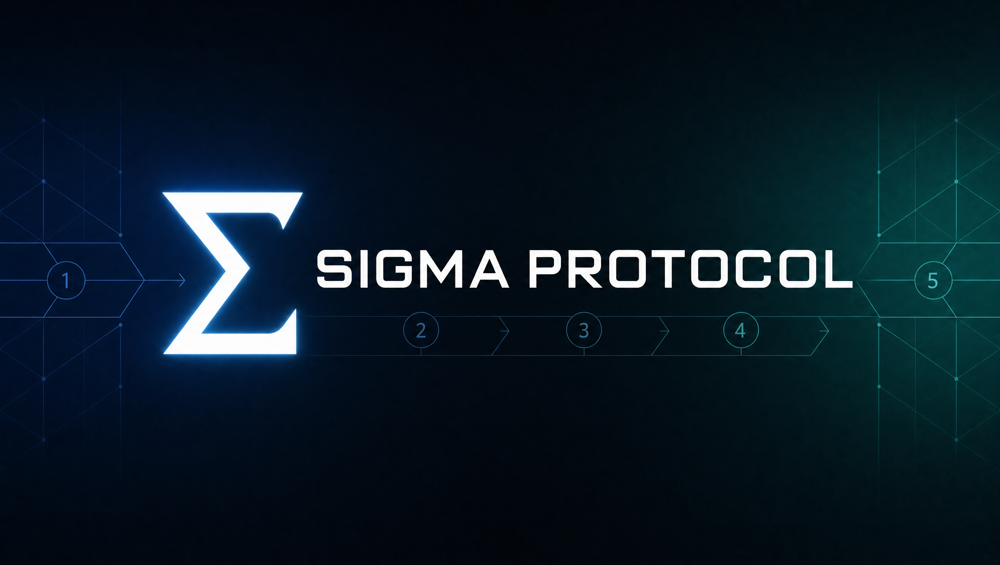

<p align="center">
  
</p>

# Sigma Protocol

**Sigma Protocol turns your idea into a real software product, step by step, with an AI assistant doing the heavy lifting.**

Think of it like two things in one:

1. **A recipe book.** 18 numbered steps take you from "I have an idea" all the way to "my product is planned, specced, and ready to build." You never have to guess what comes next — the recipe tells you.
2. **A company of AI experts.** Type `/marketing` and an AI Chief Marketing Officer shows up. Type `/engineering` and you get a CTO. There are 13 departments full of specialists, and they already know your project.

Most AI tools only check *"did the code run?"* Sigma also checks *"is it actually good?"* — with quality gates that grade the work before you move on.

---

## Start here (copy this prompt)

Clone the repo, open your AI agent (Claude Code, Codex, or Cursor) inside it, and paste this:

```text
I'm new to Sigma Protocol. Be my guide and my teacher.

1. Read GETTING-STARTED.md, AGENTS.md, and docs/WORKFLOW-OVERVIEW.md in this repo.
2. Explain to me, in plain words, what Sigma Protocol is and how the steps work.
3. Ask me what I want to build. Then start Step 0 (environment setup) and Step 1 (ideation).
4. Walk me through EVERY step in order — 0 through 15, plus 1.5 and 11.5 when they apply.
   For each step:
   - First tell me what this step is for and what we will make, in one short paragraph.
   - Work one phase at a time.
   - STOP at every gate and ask me the gate question. Wait for my real answer.
     Never skip ahead, never answer for me. If I go quiet, pause until I am back.
   - When the step is done, run its verification and show me the score before moving on.
5. After each step, give me a two-sentence recap: what we made, and why it matters.
6. When Step 15 is approved, ask if I am ready for go-to-market, then hand off to /gtm.
```

That's it. The agent reads the rules, then walks you through the whole thing and teaches you as you go.

> Want a 10-minute taste first? Follow [docs/SIGMA-LITE.md](docs/SIGMA-LITE.md) — one idea → a real spec → a quality gate grading it.

---

## How the steps work

The **Build Track** is 18 steps (0–15, plus 1.5 and 11.5 when they apply). Each step makes one real thing and saves it as a file. Later steps read the files from earlier steps — so the work stacks up like Lego.

| Step | What it does | What you get |
|------|--------------|--------------|
| 0 | Sets up your workspace | A ready project folder |
| 1 | Turns your idea into a plan | `MASTER_PRD.md` — the master plan |
| 1.5 | Figures out pricing & packaging (only if you charge money) | Offer architecture |
| 2 | Decides how the software is built | Architecture doc |
| 3 | Designs how it feels to use | UX design doc |
| 4 | Maps every screen | Screen inventory |
| 5 | Sketches every screen | Wireframe PRDs |
| 6 | Picks colors, fonts, and styles | Design system + tokens |
| 7 | Plans loading, error, and empty states | State spec |
| 8 | Writes the technical blueprint | Technical spec |
| 9 | Plans your landing page (optional) | Landing page plan |
| 10 | Breaks the product into features | Feature breakdown |
| 11 | Writes a build order for every feature | Implementation PRDs |
| 11.5 | Turns PRDs into a task list | `TASKS.md` for the build loop |
| 12 | Teaches your AI the project | `AGENTS.md` + runtime context |
| 13 | Builds project-specific skills | Custom skillpack |
| 14 | Boots the agent runtime | `.sigma/runtime/` + tools |
| 15 | Plans how you'll measure success | Observability contract |

**Two important rules the AI follows:**

- **It asks YOU at every gate.** Each step is split into phases, and each phase ends with a question only you can answer ("Approve this pricing?", "Lock this design?"). The AI must stop and wait for your answer. If you walk away, it pauses — it never decides for you.
- **Every step gets graded.** Run `@step-verify --step=N` and the step's output gets a score. Don't move on below the passing score.

After Step 5 and Step 11, run `/prd-json` to turn your plans into a machine-readable backlog. `/status` shows where you are any time. `/continue` picks up where you left off.

---

## How GTM works (after you build)

When Step 15 is approved, your product is fully planned. Sigma then asks one question: **"Ready for go-to-market?"** Say yes, and it hands off to **`/gtm`** — the Go-To-Market conductor.

`/gtm` doesn't do the marketing itself. It **conducts** the 8 **Run Tracks** — numbered business playbooks, just like the build steps, but for running the business:

| Run Track | What it covers | Steps |
|-----------|----------------|-------|
| `/run-legal` | Form your company, contracts, compliance | L0–L8 |
| `/run-finance` | Pricing, forecasts, runway | Fn1–Fn7 |
| `/run-marketing` | Positioning, channels, launch | M1–M10 |
| `/run-sales` | Pipeline, outreach, closing | S1–S8 |
| `/run-growth` | Funnels, A/B tests, retention | G1–G8 |
| `/run-content` | Scripts, videos, social posts | C1–C8 |
| `/run-community` | Discord/Telegram, onboarding | Co1–Co6 |
| `/run-ops` | Rhythm, releases, incidents | O1–O8 |

That's **64 numbered business steps** total, walked one at a time with daily tasks — same recipe style as the build. Details: [docs/run-track/README.md](docs/run-track/README.md).

---

## The departments (your AI company)

Type a department's slash command and Claude becomes that executive — with the department's methodology, your project's context, and your own history all loaded in.

**13 departments:** `/engineering` (CTO) · `/marketing` (CMO) · `/sales` (CSO) · `/product` (CPO) · `/finance` (CFO) · `/design` · `/content` · `/community` · `/ops` (COO) · `/legal` (General Counsel — with six Suits-style specialist lawyers) · `/security` (CISO) · `/qa` · `/trading` (Chief Trading Officer). Plus four shortcuts with their own personas: `/ads`, `/growth`, `/support`, and `/gtm` (the go-to-market conductor).

Under the executives sit a bundled Claude runtime roster of **60+ specialist agents** — backend engineers, copywriters, negotiators, quant strategists — each with its own tools and skills. The executive delegates to them so you don't have to. Project-authored Step 13 agent examples live separately under `src/agents/`; see [Canonical Sources](docs/CANONICAL-SOURCES.md).

```text
/marketing  What's our positioning against [competitor]?
/finance    We charge $97/mo. Should we go annual? What's the math?
/legal      Draft an NDA for a contractor.
```

Full tour: [docs/DEPARTMENTS.md](docs/DEPARTMENTS.md).

---

## The loops (set it, watch it finish)

A **loop** is a pre-built "keep going until it's actually done" cycle. You start it with one command; it only stops when a real check passes — never because the AI *feels* done. Every loop has a round limit and ends with a proof table.

| Loop | What it repeats | Stops when |
|------|-----------------|------------|
| `/step-loop --step=N` | Verify a step → fix the findings → verify again | The step's score passes for real |
| `/gap-loop` | Check the built code against the plans → fix gaps | **Two clean rounds in a row** |
| `@dev-loop` | Build every approved PRD, in dependency order | The backlog is empty |
| `/run-loop` | Next business step → today's tasks → mark done → next | You say "done for today" |

One rule never changes: **a loop can grind on work, but it can't answer your gate questions.** Decisions still stop and wait for you.

---

## The skills (what agents know)

A **skill** is a how-to file an agent loads when the task matches — like a worksheet for one exact job. The bundled pool is in `.agents/skills/`, and Step 13 authored skills are in `src/skills/`. The generated skill index is the current catalog: `.sigma/indexes/skills-index.json`.

You don't manage skills by hand. Steps and departments load the right ones automatically. Want to see them? `ls .agents/skills/`.

---

## Install

You need: `git`, `node` (v20+), `python3`, and `jq`. Then:

```bash
git clone https://github.com/Dallionking/sigma-protocol-public sigma-protocol-v2
cd sigma-protocol-v2
bash scripts/install.sh
```

The installer checks your tools, renders the step commands, installs the skills and the department system, and verifies the wiring. Then open your agent CLI in the repo and paste the **Start here** prompt above.

Works with Claude Code, Codex, and Cursor — the same files drive all of them ([docs/PLATFORMS.md](docs/PLATFORMS.md)).

---

## Learn more

| Document | What's in it |
|----------|--------------|
| [GETTING-STARTED.md](GETTING-STARTED.md) | Install → first project, start here |
| [Presentation deck](docs/presentations/sigma-protocol-deck.html) | 23-slide overview: every step, proper use, the Brain (download and open in a browser) |
| [docs/WORKFLOW-OVERVIEW.md](docs/WORKFLOW-OVERVIEW.md) | The full step-by-step workflow |
| [docs/COMMANDS.md](docs/COMMANDS.md) | Every command |
| [docs/DEPARTMENTS.md](docs/DEPARTMENTS.md) | The AI departments and how they work |
| [docs/run-track/README.md](docs/run-track/README.md) | The 8 Run Tracks (go-to-market) |
| [docs/PLATFORMS.md](docs/PLATFORMS.md) | Single-surface install + validation gates |
| [docs/CANONICAL-SOURCES.md](docs/CANONICAL-SOURCES.md) | What's authored vs generated |
| [docs/UPGRADING.md](docs/UPGRADING.md) | How to update to a new release |
| [September 2026 audit ledger](docs/audits/protocol-refresh-2026-09-19/LEDGER.md) | Prompting, framework, portability and validation findings |
| [Gate-by-gate methods refresh](docs/audits/methodology-refresh-2026-09-19/GATES.md) | All 18 steps, 91 gates, framework provenance and updated acceptance evidence |
| [docs/POSITIONING.md](docs/POSITIONING.md) | Why Sigma, and when *not* to use it |
| [CONTRIBUTING.md](CONTRIBUTING.md) | How to extend the framework |

---

## License

See [LICENSE](LICENSE). Source-available — it runs on the AI CLIs you already use, with no separate SaaS to host.

## Game-development adaptation

Game projects use the existing numbered methodology. `/game-development` is a domain entry point; Step 1 also asks what is being built. Record `projectDomain: "game"` in `docs/stack-profile.json` to load the conditional method. Missing/general projects retain their current flow.

The canonical source is `domains/game-development/catalog.json`: all 18 Protocol entries, an explicit 20-stage Atlas mapping, 12 nested workflows and 93 planning phases. See [the game guide](docs/GAME-DEVELOPMENT.md) and [step mapping](domains/game-development/STEP-MAPPING.md). Solo is the default; team mode preserves independent idea packs and explicit synthesis. Company, ownership, business, GTM, operations, context and handoffs remain part of the same system.

Game skills and role definitions prepare decisions and bounded external experiment briefs. Atlas never executes Blender/engine work or activates an agent from these records. A reviewed plan is distinct from an executed/validated asset, playable build, performance measurement or target import.

Author the catalog once, run `python3 scripts/validate-game-method.py`, then `python3 scripts/render-game-method.py`; use the normal step render/index checks. Generated skill references are portable snapshots. This repository update does not install skills globally.
