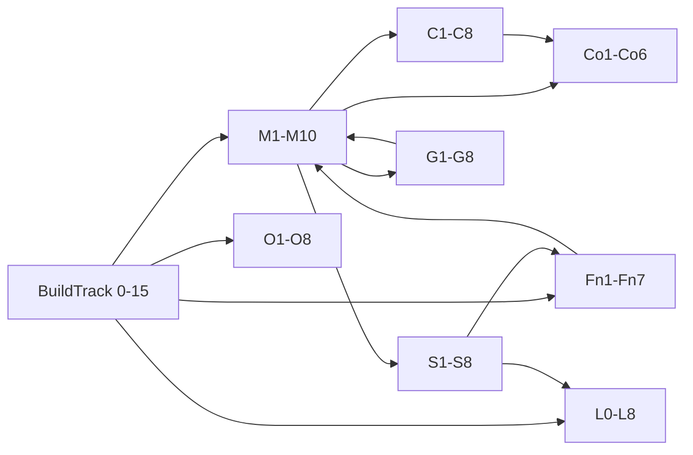

# Run Track Roadmap — Full Framework (Waves 0–4)

**Version:** 2.0.0  
**Updated:** 2026-06-29  
**Verify gate:** `node scripts/verify-run-track.mjs --wave=N` must exit 0 before advancing waves.

---

## Two rails

| Rail | Scope | Entry |
|------|-------|-------|
| **Build Track** | Product, design, engineering | Steps 0–15, `@dev-loop` |
| **Run Track** | GTM + daily operations | `/run-*` orchestrators |

**Gate-only (no Run Track):** QA (`/qa`), Security (`/security`), Trading (`/trading`).

---

## Wave table

| Wave | Departments | Steps | Orchestrators | Status |
|------|-------------|-------|---------------|--------|
| 1 | Marketing, Sales | M1–M10, S1–S8 (18) | `/run-marketing`, `/run-sales` | Done |
| 2 | Content, Growth | C1–C8, G1–G8 (16) | `/run-content`, `/run-growth` | Framework |
| 3 | Community, Ops | Co1–Co6, O1–O8 (14) | `/run-community`, `/run-ops` | Framework |
| 4 | Finance, Legal | Fn1–Fn7, L0–L8 (16) | `/run-finance`, `/run-legal` | Framework |

**Total:** 64 numbered steps + 8 orchestrators.

**Clean install:** per-project outputs gitignored — see [CLEAN-INSTALL.md](./CLEAN-INSTALL.md).

---

## Prefix rules

| Department | Step prefix | PRD prefix | Never use |
|------------|-------------|------------|-----------|
| Marketing | M | M01.001 | — |
| Sales | S | S01.001 | — |
| Content | C | C01.001 | bare `C` alone in IDs |
| Growth | G | G01.001 | — |
| Community | Co | Co01.001 | bare `C` (Content owns C) |
| Ops | O | O01.001 | — |
| Finance | Fn | Fn01.001 | `F` (Build Track F01.001) |
| Legal | L | L01.001 | — |

---

## Department matrix

| Department | Rail | Head | Orchestrator |
|------------|------|------|--------------|
| Marketing | Run | CMO | `/run-marketing` |
| Sales | Run | CSO | `/run-sales` |
| Content | Run | Content Director | `/run-content` |
| Growth | Run | Growth Engineer | `/run-growth` |
| Community | Run | Community Lead | `/run-community` |
| Ops | Run | COO | `/run-ops` |
| Finance | Run | CFO | `/run-finance` |
| Legal | Run | General Counsel | `/run-legal` |
| Product, Design, Engineering | Build | CPO / Design / Architect | `step-*`, `@dev-loop` |

---

## Triggers (`.sigma/run-track.json`)

| Orchestrator | Default trigger |
|--------------|-----------------|
| `/run-marketing` | After Step 11 PRDs approved OR Step 1 |
| `/run-sales` | After M2 or Step 1.5 |
| `/run-content` | After M6 (editorial calendar) |
| `/run-growth` | After M3 (analytics connected) |
| `/run-community` | After M2 or M8 (launch-heavy) |
| `/run-ops` | After Step 11 or first `@dev-loop` sprint |
| `/run-finance` | After Step 1.5 (offer architecture) |
| `/run-legal` | After Step 1 (entity/product defined) |

---

## Infrastructure (Wave 0)

| Artifact | Purpose |
|----------|---------|
| `scripts/run_track_manifest.py` | Single source of truth for all steps |
| `scripts/generate-run-track-steps.py` | Idempotent step + skill generation |
| `scripts/patch-run-track-registry.py` | Registry wiring |
| `scripts/sigmahq-sync-run-track.py` | Kanban sync (`--dept all`) |
| `scripts/verify-run-track.mjs` | External acceptance gate |
| `schemas/sigma-run-prd.schema.json` | Run PRD JSON schema |
| `.sigma/backlogs/{dept}/prd.json` | Per-department backlog |

---

## Per-wave loop

1. Research sprint → `RESEARCH-{DEPT}.md`
2. Update `SKILL-GAP-ANALYSIS.md` + `BUSINESS-MODEL-MODULES.md`
3. Atom skills (checklist-only)
4. `python3 scripts/generate-run-track-steps.py`
5. `./scripts/sync-steps-to-platforms.sh`
6. `python3 scripts/patch-run-track-registry.py`
7. `node scripts/verify-run-track.mjs --wave=N` → 100%
8. Update `docs/DEPARTMENTS.md`, `docs/COMMANDS.md`, `steps/README.md`

---

## Product-repo entry checklist (example — not framework)

After Wave 4 verify passes at 100% in **sigma-protocol**, founders run in **their product repo**:

1. `sigma init` + Build Track Steps 0–15
2. `@continue --source=run-track` — guided walkthrough (Legal L0 → Finance → Marketing → Sales → Growth → Content → Community → Ops)
3. `@dev-loop` in parallel throughout

Manual orchestrators (skip walkthrough): `/run-marketing`, `/run-sales`, `/run-content`, `/run-growth`, `/run-community`, `/run-ops`, `/run-finance`, `/run-legal`

---

## Cross-wave dependencies

See also: [RUN-TRACK-ACCEPTANCE.md](./RUN-TRACK-ACCEPTANCE.md), [README.md](./README.md).
